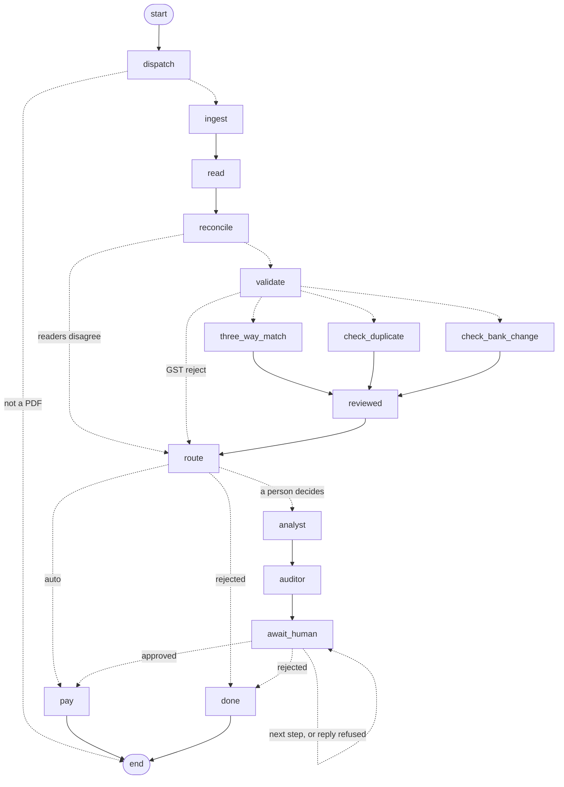

# The agent runtime (Phase 3)

Khata's agents run as one LangGraph workflow per invoice, checkpointed in
Postgres. LLMs read documents and write explanations. Code decides everything
else: what the invoice says, whether to trust the reading, every check, the
route, who may approve, and the payment draft.

```sh
make seed            # fresh database (also clears workflow checkpoints)
make demo            # D01-D09 through the workflow with live LLMs; labelled replies play the humans
uv run khata submit data/invoices/D02_DPK_DPK-1187.pdf     # stops at the approval gate
uv run khata pending
uv run khata decide 10 --as priya approve Matches PO and goods received
uv run khata show 10 # the run's messages, agent notes and every LLM call
make graph           # the graph below, as Mermaid
```

## The graph (`khata/graph/workflow.py`)



| Node | Agent | What it does |
|---|---|---|
| dispatch | Dispatcher | `classify_input`: rules, not a model. A PDF is an invoice; a decision must start with *approve* or *reject* |
| ingest | Intake | `extract_invoice` (pdfplumber text, marked untrusted) and the invoice row, with the run's thread id |
| read | Intake | Two readers **in parallel**: Groq `gpt-oss-120b`, and OpenRouter (free models, with fallbacks) |
| reconcile | Intake (code) | Compares the readings; see below |
| validate | Intake | `validate_gst`, `detect_injection` (regex + Prompt Guard 2) |
| three checks | Verifier | `three_way_match`, `check_duplicate`, `check_bank_change`: three parallel branches |
| route | Router | `route_approval`: the policy from the `rules` table sets the gate |
| analyst | Analyst | Note for the approver, citing past decisions (Groq) |
| auditor | Auditor | Checks the note against the facts, on **another provider** (OpenRouter) |
| await_human | Router | `interrupt()` with the approval request; on reply, `record_decision` |
| pay | Payer | `draft_payment`: NEFT CSV + journal. Never pays |

Every tool call goes through the ToolGateway as the agent that owns it, so
the per-agent allowlist and the `tool_calls` log apply to the graph exactly as
they did to the Phase 2 pipeline.

The Analyst and Auditor only run when a person has to decide. Auto-approved
and rejected invoices cost no review calls, which matters on free tiers.

## Two readers, and when to trust them (`khata/agents/intake.py`)

The readers transcribe; they don't calculate. Amounts come back as the printed
strings ("73,632.00") and Khata parses them into Decimals.

`reconcile` is pure code:

| Situation | Outcome |
|---|---|
| Critical fields (**total, supplier GSTIN, invoice no, bank account**) differ | `EXTRACTION_DISAGREEMENT`: **ON_HOLD with both readings**, checks skipped (checking unconfirmed data could wrongly reject) |
| Agreed critical value not found verbatim in the document text | `LOW_CONFIDENCE` (catches both models hallucinating the same value) |
| Only one reader answered, or both came from the same model | `LOW_CONFIDENCE` |
| Lowest reader confidence < `min_extraction_confidence` (0.70, in the policy) | `LOW_CONFIDENCE` |
| Neither reader answered | The run stops with `ExtractionFailed`; `khata retry <id>` re-runs it |

Both readings, the disagreements and the notes are stored on the invoice
(`invoices.extracted.readings`) and in `agent_notes`.

## Untrusted text (`khata/agents/prompts.py`)

Invoice text is passed inside `<untrusted-document-HASH>` … `</untrusted-document-HASH>`,
where HASH comes from the text itself, so a document can't contain a valid
closing tag. The system prompt says the block is data and asks the model to
quote, not follow, anything addressed to software. That lowers the odds. It
isn't what makes Khata safe; this is:

1. The **permission layer**: an agent can't call a tool off its allowlist, whatever it's told.
2. **Deterministic checks and policy**: no LLM output sets a flag, a route or an amount.
3. **Two injection detectors**: the regex detector, and
   **Llama Prompt Guard 2** (86M, on Groq) scoring the text in overlapping windows
   (it reads ≤512 tokens). A score ≥ `injection_score_threshold` (0.90, in the policy) adds `INJECTION`.

What we measured on the 31 invoices: Prompt Guard scores D09's note at 0.998
and every clean invoice near 0.001. It **misses G20**, where the instruction is
split across a line-item description (0.0006). The regex detector catches
both. The classifier is a second layer, not a replacement.

## Analyst and Auditor (`khata/agents/review.py`)

The Analyst gets the recorded facts (fields, flags, each check's findings, the
policy outcome) and the vendor's knowledge: notes plus past human decisions
with their reasons. Code then removes any precedent the Analyst cites that
wasn't among the decisions it was shown. On D04 the Analyst cites D03
(MST/INV/7731), where Priya approved freight up to 4%.

The Auditor runs on a different provider and checks the note: numbers, flags,
precedents, and consistency with the policy outcome. Its verdict goes into the
approval request ("Auditor agrees" or "Auditor disagrees: …"). Neither can
change the route.

Every LLM output is a Pydantic model with `confidence` and `reasons`
(`khata/agents/schemas.py`).

## The approval gate

`await_human` calls LangGraph's `interrupt()` with the approval request: who
must approve next, flags, hard stop and callback instruction, the Analyst's
note and the Auditor's verdict, and a ready-to-post message. The run's state is
in Postgres (`AsyncPostgresSaver`, tables in schema `khata`), so the process
can exit. `khata decide` in any later process resumes it with
`Command(resume=reply)`.

`record_decision` decides whether a reply counts. A refused reply (wrong person,
wrong step, no reason) doesn't end the run: it pauses again, and the request now
says why the reply wasn't recorded. A two-step approval pauses once per step.

## LLM client (`khata/llm.py`)

- OpenAI-compatible chat completions for both providers; strict `json_schema`
  output (falls back to `json_object` if a model rejects it), temperature 0,
  validated by Pydantic, with one repair attempt.
- Rate limits: honours `retry-after` and Groq's `x-ratelimit-reset-*`; backs
  off on 5xx and timeouts. A wait over 65 s (a daily cap) moves straight to
  the next endpoint.
- OpenRouter is called with a `models` list
  (`OPENROUTER_MODEL`, then `OPENROUTER_FALLBACK_MODELS`), because free models
  are often rate-limited upstream. Groq `qwen3.8-27b` is the last resort for the
  second reader and the Auditor.
- Disk cache (`.cache/llm/`, gitignored) keyed by models + prompts + schema,
  so re-runs and evals don't spend quota twice.
- Every call, including cache hits and failures, goes into `llm_calls`
  with the invoice id, provider, model, attempts, tokens and time.

| Role | Chain |
|---|---|
| Reader A | Groq `GROQ_MODEL` |
| Reader B | OpenRouter (`OPENROUTER_MODEL` + fallbacks) → Groq `GROQ_SECONDARY_MODEL` |
| Analyst | Groq `GROQ_MODEL` → `GROQ_SECONDARY_MODEL` |
| Auditor | OpenRouter → Groq secondary → Groq (never the Analyst's model) |

## Restart safety

A node can be replayed after a crash, so each one checks the invoice's state
before writing: ingest finds its row by the run's thread id, checks don't
re-run past their state, `route_approval` is idempotent, and payments have a
unique idempotency key.

## Tests

- `tests/test_llm.py` (14): strict schema shape, parsing, retry-after, daily cap →
  next endpoint, 5xx fallback, OpenRouter errors inside a 200, repair, json_object
  fallback, cache, Prompt Guard windows.
- `tests/test_intake.py` (20): parsing, every critical-field disagreement, readers
  down, same model, ungrounded values, low confidence, the untrusted wrapper,
  decision parsing.
- `tests/test_graph.py` (19): the real graph + Postgres checkpointer + tools, with
  fake providers behind the real LLM client. The D01–D09 labelled outcomes;
  D04 cites D03 and a made-up precedent is removed; Analyst and Auditor on different
  providers; D08's hard stop; a G12 approval across **three separate runtimes**
  with refused replies in between; disagreeing readers → ON_HOLD with both
  readings and no checks; providers down → run stops, `retry` finishes it.
